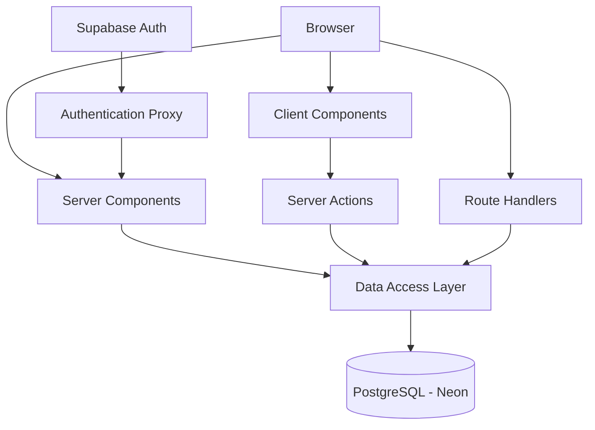

# System Architecture - Next.js Dashboard

## Architecture Diagram

## Browser and Client Components
The browser displays dashboard pages, forms, and navigation. Client Components manage interactive controls such as search and form inputs.

## Server Components
Next.js Server Components render dashboard pages on the server. They retrieve data without exposing database credentials to the browser.

## Server Actions and Route Handlers
Server Actions in app/lib/actions.ts process create, update, and delete operations. Route Handlers provide server-side endpoints for application features.

## Data Access Layer
The app/lib/data.ts module contains database queries. It separates database operations from the interface.

## Database
The application uses PostgreSQL with Neon. Database tables include customers, invoices, revenue, and users.

## Authentication
Supabase Auth manages authentication and proxy.ts protects dashboard routes. Legacy NextAuth files remain in the project and require review.

## Maintenance
Major framework updates should be tested before deployment. Database backups, logging, dependency updates, and service retirement procedures should be documented.

## Application Maintenance and Lifecycle

### Next.js Major Updates
- Review Next.js release notes and breaking changes before upgrading.
- Test major updates in the local environment first.
- Run linting, build checks, and application tests.
- Deploy to Preview and verify functionality before Production.

### Database Backups
- Configure and verify automated PostgreSQL backups.
- Take a backup before major database migrations.
- Test database restoration periodically.
- Keep database credentials in environment variables.

### Logging and Monitoring
- Review Vercel deployment and runtime logs.
- Monitor authentication failures and database errors.
- Never expose passwords, tokens, or personal data in logs.

### Dependency and Security Updates
- Use Dependabot to check npm dependencies weekly.
- Review and test dependency update pull requests before merging.
- Apply critical security patches promptly.

### Project Retirement
- Notify users before shutting down the application.
- Export required data and follow applicable retention rules.
- Revoke API keys, database credentials, and service access.
- Remove unused deployments and infrastructure.
